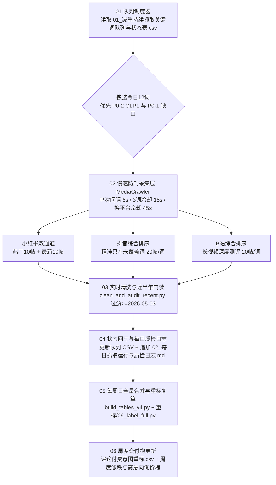

# 减重方向持续数据采集与周度复算工作流手册（慢速 · 高准度 · 全覆盖）

> **结论先行**
> 1. **已有基线资产（无需重抓）**：本地已沉淀 **4,230 篇近半年帖子**（2026-05-03 至今，来自 `02_内容主表_全量帖子明细.csv`）与 **103,968 条全量去重评论 / 93,410 条净有效评论**（来自 `评论付费意图重标.csv` 与 `03_评论总表_全量评论明细.csv`），且 **P1 主干 30 词**在小红书、抖音、B站三平台的基线覆盖率已达 **100%（30/30 词均 ≥5 帖，累计 1,755 帖、57,639 条评论）**。
> 2. **核心缺口实测结果（脚本自动扫描 `MediaCrawler/data/*/jsonl` 真实落盘统计）**：在您拍板优先补齐的 **P0 队列（共 48 词：P0-1 第 5 词包深水区 38 词 + P0-2 GLP-1 用药与停药反弹专项 10 词）** 中，小红书已覆盖 **39/48 词**、B站已覆盖 **40/48 词**，而**抖音仅覆盖 16/48 词（缺 32 词）**，且 **P0-2 新增的 8 个 GLP-1 停药反弹/掉肌肉/恶心食谱词在三平台均为 0 帖待抓**。
> 3. **已落地工作流与拉长间隔防封配置**：已编写并验证 `03-抓取工具/weight_loss_continuous_pipeline.py`，将单次请求休眠从原 `2秒` **拉长 3 倍至 `6秒`**，每抓 3 词冷却 **15 秒**，跨平台切换冷却 **45 秒**；单日自动拣选 **12 个未覆盖词**（智能跳过该词已达标的平台，只补缺口平台），并在每周日自动触发 `build_tables_v4.py`（全平台去重合并）与 `重标/06_label_full.py`（S01–S11 人群 × P1–P9 付费意图上下文重标）。

---

## 一、已有数据资产 vs 待补数据缺口全景盘点

### 1.1 本地已有「减重」核心资产（可随时复算，不重复消耗配额）

| 资产模块 | 本地文件路径 | 样本量与统计口径 | 已解决的业务问题 |
|---|---|---|---|
| **五平台内容与评论总表（v4）** | `02-调研数据/减重课程五平台数据/08_原始数据总表_v4.xlsx`<br>`02_内容主表_全量帖子明细.csv`<br>`03_评论总表_全量评论明细.csv` | 内容 **4,230 篇**；原始去重评论 **103,968 条**，剔除纯表情/小于2字/无意义语气词后净有效评论 **93,410 条** | 锁定近半年（`2026-05-03` 之后）真实发帖与评论互动底盘，按 `(platform, content_id / comment_id)` 100% 物理去重 |
| **评论付费意图与人群重标库** | `02-调研数据/评论重标/评论付费意图重标.csv`<br>`评论上下文宽表.csv`<br>`03-抓取工具/重标/06_label_full.py` | **103,968 条**评论逐条带原帖标题/正文上下文标注，覆盖 **S01–S11（11个人群包）× P1–P9（9类付费意图与痛点标签）**，原帖关联率 **99.9%+** | 区分真询价（P1）、求食谱方案（P2）、执行卡点（P3）、竞品差评吐槽（P4）与玩梗反讽噪音 |
| **卖课商家与私域引流摸底** | `02-调研数据/卖课与服务商家调研/`<br>`02-调研数据/私域引流账号调研/` | **101 家卖课商家 / 198 个 SKU / 8 个私域营养师样本**；**100 个私域引流账号**（10 种钩子链路，抖音 823 条内容 12.4% 触发求助、小红书 1,278 条 7.4% 触发求助且 **31% 求助无人回复**） | 摸清录播课（中位 232.8 元）、训练营（中位 1,248.5 元）、1v1 服务包（中位 1,689.5 元）价格双峰与 500–1,100 元价格断档 |
| **P1 主干抓取词包（前4包）** | `03-抓取工具/MediaCrawler/run_survey_batches.py`（`pack1`–`pack4` 共 30 个独立词） | 三平台（小红书/抖音/B站）覆盖率 **30/30（100%）**，累计近半年有效帖 **1,755 篇**、有效评论 **57,639 条** | 完成胰岛素抵抗、多囊、脂肪肝、平台期、16+8、代餐、训练营等基础盘面采样 |

### 1.2 实测待补数据缺口与持续采集优先级（按已拍板方案排序）

通过 `py 03-抓取工具/weight_loss_continuous_pipeline.py --mode status` 对 `MediaCrawler/data/` 下所有 JSONL 原始文件逐词扫描，当前 **P0 队列（48 词）** 的真实缺口如下：

| 优先级 | 词包名称 | 词数 | 三平台当前已覆盖词数（≥5帖） | 待补缺口明细（实测数据） | 预计补齐耗时（按每日12词慢速档） |
|---|---|---:|---|---|---|
| **P0-2（最高优）** | `pack6_glp1_lifecycle`<br>GLP-1 用药期与停药反弹专项 | **10 词** | 小红书 **2/10**<br>抖音 **1/10**<br>B站 **2/10** | 仅「司美格鲁肽副作用」「替尔泊肽减肥效果」有部分数据；新增 **8 个高转化痛点词**（`司美格鲁肽停药反弹怎么补救`、`替尔泊肽停药会复胖吗`、`司美格鲁肽恶心想吐吃什么`、`打减肥针掉肌肉松弛怎么办`、`司美格鲁肽减重食谱搭配`、`替尔泊肽和司美格鲁肽哪个好`、`减肥针停针后怎么维持体重`、`司美格鲁肽平台期不掉秤`）三平台全为 **0**，且「替尔泊肽减肥效果」缺抖音 | **Day 1（第1天）** 即可全量补齐 8 个新词 + 抖音缺口 |
| **P0-1（高优）** | `pack5_deep_tracks`<br>第5词包深水区（皮质醇/内脏脂肪/抗炎/中医湿气/代谢补剂） | **38 词** | 小红书 **37/38**<br>抖音 **15/38**<br>B站 **38/38** | 小红书与B站已完成 97%+ 原生抓取，但**抖音在「抗炎代谢 24 个细分词」上当时未跑完**（共 **23 个词在抖音为 0 帖**，如 `降皮质醇减肥食谱`、`压力肥熬夜肥怎么调代谢`、`慢性炎症内脏脂肪`、`抗炎饮食瘦肚子`、`桥本抗炎饮食减肥`、`多囊抗炎饮食食谱`、`节食代谢受损怎么恢复`、`提高代谢补剂推荐` 等），小红书仅差 `提高代谢补剂推荐` 1 词 | **Day 1 – Day 3（共3天）** 精准只抓缺失平台（主要是抖音 23 词 + 小红书 1 词），不重复抓已达标的 B站/小红书 |
| **P1（周期复刷）** | `pack1`–`pack4`<br>高付费人群/执行卡点/竞品避坑/免费基准 | **30 词** | 小红书 **30/30**<br>抖音 **30/30**<br>B站 **30/30** | 基线已 100% 建好（1,755 帖 / 57,639 评论）。在 P0 全部清零后（Day 4 起），按每周 1 轮慢速滚动抓最新帖（`time_descending`），追踪**前后3个月声量增速环比**与**评论区新增无人回复询价帖** | **Day 4 起**进入常态化周度滚动增量监测 |
| **P2（专项人工/半自动补充）** | 外部商业库与晚间直播快照 | 专项 | 按周抽样 | ① 竞品直播间晚间黄金档（20:00–23:00）「已售/已抢」及商品差评用 `ego-browser` 周度快照；② 抖音二级评论 `parent_comment_id` 映射修复后复算抖音真实无人回复率；③ 灰豚图片型 PDF 报告按需抽样视觉提取 | 按需触发，不挤占每日爬虫配额 |

---

## 二、「慢速、高准度、全覆盖」持续采集与复算工作流架构



### 2.1 五级防封与慢速配额参数（已写入脚本默认配置）

针对小红书 IP 限流与抖音滑块/账号风控，工作流将原本紧凑的批量抓取拆解为**「小步慢跑、平台跳过、多级冷却」**：

1. **单次翻页/请求休眠拉长 3 倍**：`CRAWLER_MAX_SLEEP_SEC = 6`（原配置为 `2` 秒，现拉长至 `6` 秒）。
2. **微批次切片（Chunk = 3 词）**：每次启动 MediaCrawler 进程最多只传 **3 个关键词**，抓完 3 个词强制进程退出并冷却 **15 秒**（`--kw-cooldown 15`），避免长连接连续搜索触发风控。
3. **单平台智能跳过（Zero Redundancy）**：例如 P0-1 的 `降皮质醇减肥食谱` 在小红书（10帖）和 B站（19帖）已达标，仅抖音为 `0帖`，调度器会自动跳过小红书与 B站，**只在抖音抓取该词**，将每日请求量压缩 60% 以上。
4. **跨平台切换长冷却**：一个平台抓完并完成 JSONL 时间窗清洗后，强制等待 **45 秒**（`--plat-cooldown 45`）再切换下一平台。
5. **小红书双通道采集**：每个待抓词在小红书固定拆为 **10 帖最热（`popularity_descending`，看头部爆款供给）+ 10 帖最新（`time_descending`，抓素人真实求助与刚发出的未回复询价）**；单帖抓一级评论 50 条 + 二级楼中楼。

### 2.2 六道数据准度与质检硬门槛（Quality Gates）

每次每日增量抓取与每周日汇总复算，必须通过以下 6 项硬指标校验（自动记录在 `02-调研数据/减重持续监测/02_每日抓取运行与质检日志.md`）：

| 质检维度 | 合格门槛与算法口径 | 异常处理机制 |
|---|---|---|
| **1. 近半年时效硬门槛** | `publish_ts >= 1777737600`（`2026-05-03 00:00:00`），且单列近 3 个月（`2026-08-04` 至今）帖数占比 | `clean_and_audit_recent.py` 先备份 `.raw_bak`，再自动剔除早于 2026-05-03 的旧帖及其挂载评论 |
| **2. 全局物理去重** | 内容按 `(platform, note_id/aweme_id/video_id)` 去重；多词命中同一帖自动合并入 `matched_keywords` 数组；评论按 `comment_id` 去重 | `build_tables_v4.py` 全量合并不丢字段，杜绝一帖多算导致互动量虚高 |
| **3. 跨界同形词排雷** | 严禁直接裸搜 `反弹`（股票）、`代餐`（二次元小说）、`16+8`（1688拿货）、`营养师`（考证培训）、`减脂营`（纯菜谱） | 队列 78 词已全部加上场景限定词（如 `减肥反弹后怎么减`、`代餐减肥有用吗`），并在 `homonym_scan.py` 二次巡检 |
| **4. 评论与原帖关联率** | `06_label_full.py` 中评论表 `内容ID` 与内容主表 `平台内容ID` 左连接匹配率须 **≥ 98%**（当前基线为 **99.9%+**） | 确保每条短评论（如“怎么买”“求带”）都能结合原帖标题与正文判定真实意图，不孤立打标 |
| **5. 反讽/玩梗/转述剥离** | `context_rules.py` 独立输出 `是否反讽/玩梗/转述` 与 `上下文是否充分` 字段 | 算高付费询价率（P1）与痛点占比时，严禁把玩梗调侃计入真实患者痛点 |
| **6. 样本充足度底线** | 单词单平台有效帖 `< 5 帖` 标为 `少量_待补`；周报涨跌榜要求当周该词有效帖 `≥ 20 帖`，不足一律标「样本不足」 | 严禁在小样本（如几条帖子）上强算环比涨跌幅或下结论 |

---

## 三、操作命令速查与自动化定时任务说明

### 3.1 核心脚本与产出文件清单

| 文件用途 | 绝对路径 |
|---|---|
| **持续采集与周度复算主控脚本** | `D:\A-灵知生物\小程序\05-市场调研\03-抓取工具\weight_loss_continuous_pipeline.py` |
| **面向运营与调度的关键词队列排期表（CSV）** | `D:\A-灵知生物\小程序\05-市场调研\outputs\减重持续采集关键词队列与排期表_用于每日慢速抓取调度与状态追踪.csv` |
| **监测工作区内部状态表（CSV）** | `D:\A-灵知生物\小程序\05-市场调研\02-调研数据\减重持续监测\01_减重持续抓取关键词队列与状态表.csv` |
| **每日抓取运行与质检日志（Markdown）** | `D:\A-灵知生物\小程序\05-市场调研\02-调研数据\减重持续监测\02_每日抓取运行与质检日志.md` |
| **周度更新后的全量五平台原始总表（v4）** | `D:\A-灵知生物\小程序\05-市场调研\02-调研数据\减重课程五平台数据\08_原始数据总表_v4.xlsx` |
| **周度更新后的 10万+ 评论付费意图重标总表** | `D:\A-灵知生物\小程序\05-市场调研\02-调研数据\评论重标\评论付费意图重标.csv` |

### 3.2 手动运行与自检命令（PowerShell 5.1）

```powershell
# 1. 查看当前 P0/P1 队列三平台覆盖进度并刷新排期表
$env:PYTHONUTF8="1"; py "D:\A-灵知生物\小程序\05-市场调研\03-抓取工具\weight_loss_continuous_pipeline.py" --mode status

# 2. 预览今日待抓的 12 个关键词与各平台缺口（Dry-Run，不启动浏览器）
$env:PYTHONUTF8="1"; py "D:\A-灵知生物\小程序\05-市场调研\03-抓取工具\weight_loss_continuous_pipeline.py" --mode daily --batch-size 12 --sleep-sec 6 --dry-run

# 3. 正式执行今日慢速增量抓取（单次间隔 6s，词间冷却 15s，平台冷却 45s）
$env:PYTHONUTF8="1"; py "D:\A-灵知生物\小程序\05-市场调研\03-抓取工具\weight_loss_continuous_pipeline.py" --mode daily --batch-size 12 --sleep-sec 6

# 4. 执行周度全量合并去重 + S01-S11×P1-P9 评论重标复算
$env:PYTHONUTF8="1"; py "D:\A-灵知生物\小程序\05-市场调研\03-抓取工具\weight_loss_continuous_pipeline.py" --mode weekly
```

### 3.3 已配置的本地定时任务（Automations）

根据您的确认，已在本机配置两条自动化工作流（结果直接投递回当前会话，注意：本地定时任务需保持 Factory 桌面端或后台守护进程开启，且若小红书/抖音登录态过期弹出二维码，请在浏览器窗口扫码放行）：

1. **每日减重慢速增量采集与质检（Daily）**
   - **触发时间**：每天 `10:30`（`30 10 * * *`）
   - **执行动作**：运行 `--mode daily --batch-size 12 --sleep-sec 6`，按优先级补抓 P0-2（GLP-1 全周期专项）与 P0-1（第 5 词包抖音/小红书缺口），完成后自动执行近半年时间过滤去重，更新队列状态表与质检日志，并向本会话汇报当日净增帖数、净增评论数与剩余缺口。
2. **每周日减重全量合并去重与付费意图重标周报（Weekly）**
   - **触发时间**：每周日 `21:00`（`0 21 * * 0`）
   - **执行动作**：运行 `--mode weekly`，顺序调用 `build_tables_v4.py --platform all` 与 `重标/06_label_full.py`，复算 S01–S11 人群包与 P1–P9 付费意图分布（重点对比 GLP-1 停药反弹、皮质醇压力肥、内脏脂肪抗炎等赛道的询价密度与痛点变化），输出周度增量简报。

---

## 四、数据边界与合规声明

1. **采样性质声明**：本工作流采集的数据为各平台关键词搜索下的**覆盖式分层抽样（Top 热门 + 最新求助）**，用于洞察用户痛点结构、询价密度与内容供需缺口，**不代表平台全网大盘绝对总量**。
2. **跨平台可比性边界**：不同平台的点赞/评论基数与推荐分发机制存在量级差异，周度趋势与热度对比严格在**同一平台内部**计算分位数或环比，不将小红书点赞与抖音点赞直接相加排名。
3. **账号风控与人工介入边界**：虽然已将抓取间隔拉长至 `6秒/次` 并增加多级冷却，但抖音与小红书的登录态（Cookie）每隔数天可能自然过期或触发滑块验证；当每日日志提示某平台返回条数为 0 时，需人工扫码更新一次 `browser_data/<平台>_user_data_dir` 登录态。
