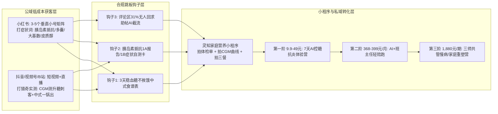

# 小红书与抖音大健康商家推流趋势、爆款钩子公式及公转私承接方案报告

> **用途说明**：本报告直接回答三个核心问题：**① 哪些大健康赛道在持续重金投流、哪些投流在减少退潮？② 跑通 ROI 的爆款素材前 3 秒钩子怎么写？③ 慢病/减重/营养商家如何规避医疗违规限流，把公域流量低成本导进私域与小程序？**
> **数据底座与客观代理指标声明（严守事实边界，不拍脑袋）**：
> - 巨量千川与小红书聚光后台的单客账户消耗属于商业机密，外部无法拉取全网账单；本报告全部结论建立在**三源客观证据交叉**之上：
>   1. **灰豚企业版实测数据（2026-11-04 只读查询）**：`02-调研数据/灰豚验证/灰豚_XHS_建议.md`、`灰豚_XHS_品牌与内容.csv`（8 大品牌近 30 天关联笔记、商业合作笔记数、SOV 排名及 8 大关键词前 80 条笔记广告密度实测）。
>   2. **本地五平台全量内容与私域引流拆解库**：`01-调研报告/私域引流账号调研/`（100 个健康账号私域链路拆解、抖音 823 篇/37,431 条评论与小红书 1,278 篇/26,419 条评论的「暗导求助」复算）、`01-调研报告/抗炎饮食五族调研/01-五族词表.csv`（252 词标题层商家占比 `merchant_title_share` 实测）、`01-调研报告/减重课程市场调研/减重课程市场调研-四万条评论深度画像与商业深扒报告.md`（4,230 篇内容钩子提升倍数与高求索率榜单）。
>   3. **第三方商业监测报告**：千瓜数据《情绪种草新风：不吃压力（2026-07）》《2024 高增长赛道洞察》、蝉妈妈×蝉魔方《2025 年抖音电商大健康行业分析报告》、魔镜洞察《2025 线上保健品市场洞察》。
> **配套 CSV 执行表**：`outputs/小红书抖音大健康投流赛道红绿灯与钩子链路总表_用于内容选题与投流执行.csv`

---

## 〇、结论先行：四条核心发现

1. **谁在持续砸钱投流 vs 谁在撤退？（红绿灯分野极其清晰）**
   - **🟢 持续重金加码区（6 大赛道）**：① **靶向减重益生菌（早B晚S/AKK菌）**（灰豚实测万益蓝近 30 天 1,545 篇笔记中 **772 篇是商业笔记，商业投放占比高达 50.0%**，商业互动占 66%）；② **细胞级抗衰（麦角硫因 EGT/PQQ/亮白饮）**（销售额同比 **>+1000%**，抖音 NAD+ 高赞视频中 **21% 为商业投放**，中位赞达均值 2.7 倍）；③ **皮质醇/抗压力肥/助眠镁剂**（小红书「皮质醇」种草笔记近一年 **+270%**，南非醉茄商业笔记环比 **+41%**）；④ **家用动态血糖仪 CGM**（抖音健康器械销售额 TOP10 中占 7 席）；⑤ **儿童赖氨酸追高与中老年辅酶Q10/鱼油**（小红书搜「1v1营养师」前 10 条里 **9 条被母婴/奶粉品牌投流占满**）；⑥ **中式养生水与药食同源直饮包**（山楂鸡内金抖音同比 **+558%**）。
   - **🔴 投流明显缩减/退潮区（2 大赛道）**：① **传统高溢价代餐奶昔/代餐粉/轻食包**（灰豚实测康宝莱 675 篇笔记仅 41 篇商业笔记、互动仅 1.7 万；薄荷健康 296 篇中 **商业笔记为 0**；咚吃 **商业笔记为 0**，最近投放停在 2025-08；超级零近 30 天无数据——因为代餐 2 周弃用率极高、千川/聚光复购算不过账）；② **泛减重服务大牌在小红书/抖音的公域硬广**（瘦吧近 30 天仅 24 篇笔记/0 商业笔记，SOV 排第 151 名；兴趣岛仅 36 篇/0 商业笔记，停投超 1 年；且抖音课堂已于 2025-02-19 下线、2026-03 教培改定向邀约）。
   - **🟡 强监管限流→转入“自然流症状钩子+私域暗投”区**：**胰岛素抵抗、多囊、脂肪肝、四高逆转、1v1 营养陪跑**。因为《广告法》严禁非医疗机构投流承诺疾病逆转，这批玩家全部转向 **「小号矩阵铺症状词拿免费自然流 + 评论区/置顶/群聊暗导私域」**。
2. **最关键的投放铁律：小红书用户搜的是「症状词/行为词」，绝不能投「服务词/成分词」做标题！**
   - **灰豚 80 条样本实测铁证**：在小红书，**「大基数减肥（中位赞 20,000，0 广告）」「体重管理（中位赞 13,000，0 广告）」「胰岛素抵抗（中位赞 7,719，单篇 6.3 万赞，0 广告）」** 拥有庞大的免费自然流量池；而一旦换成卖服务的词——**「减脂陪跑（中位赞 456，60% 是广告）」「减脂营（中位赞 381）」「1v1营养师（中位赞 202，90% 是广告）」**，自然流量直接暴跌 **20–100 倍**，且全被投流广告塞满！
   - **抗炎五族 252 词实测铁证**：用户搜的「行为/问句词（低GI饮食、控糖食谱、内脏脂肪怎么减）」标题层商家占比均值仅 **1.9%**；而商家爱写的「成分/商品名词（白藜芦醇、锌片、多酚）」商家占比均值高达 **6.5%（相差 3.4 倍）**。**标题必须写症状与行为，卖点才写成分与服务。**
3. **抖音用户偏「买商品（36%）」，小红书用户偏「要食谱/方案（26%）」，且小红书有 31% 的求助评论无人回复！**
   - 本地对抖音（37,431 条评论）与小红书（26,419 条评论）的「暗导求助」复算显示：抖音减重内容下 **12.4%** 触发用户主动求购/求带（其中 **36% 问怎么买商品**、18% 问怎么加群、9% 求食谱）；小红书减重内容下 **7.4%** 触发主动求助（其中 **26% 求食谱/方案，是抖音的近 3 倍**！）。更惊人的是，小红书 **154 条明确求助评论中有 47 条（31%）完全无人回复**——这是灵知可以直接用 AI+人工截流的纯增量金矿。
4. **健康私域引流已收敛为「10 大标准模板」，灵知最佳打法是「小红书小号矩阵铺症状词 + B站/视频号低价课入门 + 微信小程序测评锁客」**。

---

## 一、小红书 & 抖音大健康商家「持续投流 vs 投流退潮」实测数据对比

### 1.1 灰豚数据小红书品牌投放活跃度实测表（统计窗口：2026-10 至 2026-11 近 30 天）
> **数据来源**：`02-调研数据/灰豚验证/灰豚_XHS_建议.md` & `竞品SOV.csv`（企业会员只读实测）

| 品牌名称 | 所属赛道 | 近30天关联笔记 | 合作达人数 | 商业合作笔记数 | 商业投放占比 | 互动总量 (商业互动占比) | 最近一次投放日期 | 投流状态判定与核心原因 |
| :--- | :--- | :---: | :---: | :---: | :---: | :---: | :---: | :--- |
| **万益蓝 WonderLab** | 益生菌(早B晚S)/代餐 | **1,545 篇** | 1,330 人 | **772 篇** | **50.0%** | **21.4万 (商业占66%)** | **2026-11-02** | 🟢 **持续重投霸主**：靠早B晚S益生菌高毛利持续买量，但疑问评论高达 **32.39%** |
| **康宝莱 Herbalife** | 传统蛋白代餐奶昔 | 675 篇 | 394 人 | 41 篇 | 6.1% | 1.7万 | 2026-10-30 | 🟡 **低效维持**：笔记多但互动极低（SOV互动排第118名），依靠线下俱乐部与老客私域 |
| **薄荷健康** | 21天全餐包/控卡食品 | 296 篇 | 250 人 | **0 篇** | **0.0%** | 3.1万 | 无近期商业记录 | 🔴 **公域硬广停投**：负面舆情达 **12.5%**（三家最高），转向自有App与天猫店收割 |
| **咚吃** | 21天冷链定制餐 | 81 篇 | 6 人 | **0 篇** | **0.0%** | 1,526 | **2025-08-06** | 🔴 **停止小红书投放**：高履约冷链成本难撑公域买量，退守抖音/微信私域复购 |
| **兴趣岛** | 线上养生/抗衰/减重营 | 36 篇 | 18 人 | **0 篇** | **0.0%** | 1,294 | **2025-08-13** | 🔴 **小红书停投超1年**：主战场在微信视频号/私域直播（太极营118万单），不在小红书硬投 |
| **瘦吧** | 脂20代餐+体脂秤服务 | 24 篇 | 14 人 | **0 篇** | **0.0%** | 447 | 2026-09-16 | 🔴 **公域声量微乎其微**：74%互动来自自有企业号自嗨，外部达人投放基本停滞 |
| **诺特健康** | 医疗级慢病/减重1v1 | 未收录 | — | — | — | — | — | 🟡 **纯院外/私域转介绍**：客单价1,880–26,800元，走医院营养科合作与私域，不投公域种草 |
| **超级零 / 每日的菌** | 断碳代餐盒子 / 益生菌 | 近30天无数据 | — | — | — | — | — | 🔴 **代餐盒子彻底退潮**：曾靠生酮/断碳代餐盒爆火，因反人性难坚持、复购崩盘已退出投流榜 |

---

### 1.2 小红书 8 大核心搜索词「自然流量 vs 投流广告污染度」实测对比
> **数据来源**：`02-调研数据/灰豚验证/灰豚_XHS_建议.md`（每词取前 10 条热门笔记，共 80 条实测）

| 搜索关键词 | 词属性分类 | 前10条总赞数 | 单篇中位赞 | 单篇最高赞 | 前10条中投流广告数 | 投放与选题实战判读 |
| :--- | :--- | :---: | :---: | :---: | :---: | :--- |
| **大基数减肥** | 症状/人群词 | 177,248 | **20,000** | 30,000 | **0 条 (0%)** | 🟢 **自然流王牌词**：中位赞全表第 1，全是素人/腰部真实掉秤记录，无商业广告稀释 |
| **体重管理** | 泛目标词 | 273,505 | **13,000** | 166,000 | **0 条 (0%)** | 🟢 **泛流量大盘词**：总量最大，头部多为美食/自律掉秤 Vlog |
| **控糖** | 行为方法词 | 230,447 | **9,629** | 84,000 | **3 条 (30%)** | 🟡 **高热但分词易跑偏**：30% 为品牌投流（抗糖饮/控糖片），且混入甜品测评，需用长尾词「控糖食谱」精准化 |
| **胰岛素抵抗** | 慢病指标词 | 164,582 | **7,719** | **63,000** | **0 条 (0%)** | 🟢 **高转化黄金词**：议题浓度极高，单篇《35岁男子吃凉土豆瘦22斤》获 6.3 万赞，评论区全是求方案 |
| **产后减肥** | 场景人群词 | 39,200 | **3,931** | 10,000 | **2 条 (20%)** | 🟢 **精准人群词**：体量适中，有盆底肌/居家塑形器械品牌在投流 |
| **减脂陪跑** | 服务商业词 | 8,903 | **456** | 5,375 | **6 条 (60%)** | 🔴 **广告拥挤、无自然流**：60% 被商业投流占满，用户极少直接搜这个词看内容（只在想比价时搜） |
| **减脂营** | 服务商业词 | 7,388 | **381** | 2,044 | **1 条 (10%)** | 🔴 **低互动服务词**：多为线下封闭营招生活动，线上课硬投此词性价比极低 |
| **1v1营养师** | 服务商业词 | 2,176 | **202** | 371 | **9 条 (90%)** | 🔴 **严重污染词**：10 条里 9 条被婴童奶粉/母婴大牌聚光广告买断，C端减重营养师硬抢此词必亏！ |

---

## 二、爆款推流素材公式与前 3 秒钩子话术拆解（基于 4,230 篇内容实测）

> **方法论重要警示（来自本地《减重报告附录 B》与《四万条评论深度画像报告》第 5 节）**：
> - 在全部 4,230 篇内容中，**「第一人称实证（我/亲测/实测/自述）」是唯一在全局高赞组（P90 $\ge 21,000$ 赞）出现率高于长尾组的钩子（提升倍数 $1.13	imes$，高赞组占 29.9%）**！
> - **切记：钩子倍数不能跨内容类外推！** 科普解释类内容（如胰岛素抵抗机制）用「清单式/反常识对比」有效，而服务转化类内容（高评论求索率帖）靠的是 **「第一人称结果前置 + 具体三餐食谱展示」**。

### 五大实战验证的高转化钩子公式（直接抄作业）：

| 钩子类型 | 适用目标人群 | 实测标杆案例与互动数据（来源：本地全量库） | 前 3 秒口播 / 封面标题公式 | 为什么能触发高转化/高求索？ |
| :--- | :--- | :--- | :--- | :--- |
| **公式 1：第一人称症状逆转 + 食谱悬念钩子** *(求索率冠军)* | 胰岛素抵抗 / 多囊 / 脂肪肝 / 大基数 | · 小红书《已瘦55斤｜解决胰岛素抵抗！瘦的超快🔥》(**评论求索率 56.5%**，39/69条在问怎么吃) · B站用户自述《7月查出重度脂肪肝空腹16.3，自律3个月重度脂肪肝消失，糖化4.6》(**赞 102**) | **「[痛点标签] 已瘦 X 斤 / 指标恢复正常！不吃减肥药不挨饿，全靠把 [常吃错的食物] 换成了这三顿饭」** | 用户不要听枯燥的病理课，看到“跟我一样有胰岛素抵抗/多囊的人真瘦了”，立刻在评论区刷屏“求食谱/求带” |
| **公式 2：CGM 动态血糖仪「升糖刺客」实测钩子** *(完播与转化双王)* | 30+ 体检控糖族 / 糖妈 / 饭后犯困族 | · 抖音《医生们用动态血糖仪20天后，大家开始集体反思了！》(**57.7万赞 · 24.4万藏**) · 抖音《教书人测糖：一根糯玉米，血糖直接17.3》(**2,538赞 · 123追问**) · 重标表该词求购密度 **182.0/万** | **「以为 [白粥/糯玉米/无糖麦片/水果] 很健康？戴上动态血糖仪实测 2 小时，血糖直接飙到 [数字]！这样改吃瞬间压平曲线」** | 用可视化飙升曲线击碎中国家庭常见食物误区（米饭/杂粮/玉米/水果占食物盲区榜前五），顺理成章引导进小程序查食物升糖红绿灯 |
| **公式 3：归因反转「不是你不自律，是激素/皮质醇乱了」钩子** *(情绪共鸣王)* | 少吃还不瘦 / 平台期卡秤 / 熬夜压力肥 / 多囊 | · 抖音《瘦不下来就怪自己不够自律？可能恰恰是因为你太努力了！》(**56.7万赞 · 29.7万藏**) · 抖音《练了一天智商掉了2斤 #皮质醇》(**51.3万赞**) · 抖音《多囊女生的胖，不是懒出来的，是激素乱了》(`DY-P27`) | **「每天少吃还拼命运动，体重却一斤不掉？别再怪自己不自律了！有这 3 个信号（下午4点心慌手抖/脖子发黑/凌晨3点醒），你是典型的 [胰岛素抵抗/皮质醇过劳肥]」** | 先帮用户卸下“懒馋罪恶感”，再用具体体感症状（1B症状型 89.7% 关注饿与心慌）完成精准自筛，评论区自动求自测表 |
| **公式 4：中式家常「一锅出/穷养身体」平替钩子** *(高收藏干货王)* | 外卖打工人 / 宝妈家庭同餐 / 讨厌白人饭人群 | · 抖音《宿舍党狂喜，没有油烟味的一锅出！》(**102.5万赞 · 38.5万藏**) · 抖音《几块钱一顿的早餐非要自己做》(**74.1万赞**) · 抖音《穷养身体，富养认知！怎样用最少的钱吃够一天所需营养》(**50.9万赞**) | **「别再花几千块买难吃的代餐和冷沙拉了！菜市场 10 块钱买齐的抗炎控糖家常菜，一锅出全家老小都能吃」** | 精准击中 2,146 条“无法跟家人分餐”和 1,113 条“西式抗炎餐太贵伤胃”的痛点，建立极高信任感 |
| **公式 5：躺练/低门槛「不伤膝盖跟练」钩子** *(泛流量破圈王)* | 久坐上班族 / 产后妈妈 / 50+ 中老年 | · 抖音《继续带姐妹们躺着瘦全身，核心燃脂法不跑不跳》(**234.9万赞 · 323.4万藏**) · B站《10分钟缓餐后血糖，降低压力慢性炎症超慢跑》(**藏赞比 4.59**) · B站《多囊+胰岛素抵抗20分钟无跳跃抗阻跟练》(**藏赞比 7.12**) | **「大基数/多囊胰岛素抵抗千万别瞎跑伤膝盖！每天饭后 15 分钟 [超慢跑/八段锦/无跳跃抗阻]，边看电视边降餐后血糖」** | 收藏率极高（藏赞比 4.0–7.1），适合作为视频号/B站/抖音的前端泛流量入口，在视频结尾挂载打卡群 |

---

## 三、慢病/减重商家如何规避医疗违规限流、完成公转私承接？（本地 100 账号实测）

### 3.1 必须避开的 4 类高危违规话术（来自 `01-调研报告/私域引流账号调研/07-高风险话术清单.md`）
| 违规等级 | 典型高危踩雷原话（本地样本实抓） | 触发的平台处罚与法律风险 | 灵知生物合规改写标准（安全且高转化） |
| :--- | :--- | :--- | :--- |
| **L1 疗效承诺** | *“3招活络气血远离癌症” / “3个月让毛囊复活” / “过敏体质逆转指南” / “一个月保瘦20斤”* | 违反《广告法》第17条，抖音/小红书直接封禁账号或掐断商业流量 | 改写为**过程与习惯周期** + **真实个案免责声明**：“21天抗炎饮食重启打卡”、“改善餐后犯困体感” |
| **L2 替代治疗** | *“膝盖痛千万别乱打针，不开刀逆转关节炎” / “脂肪肝不是吃油多，是脾湿太重”* | 诱导患者停药/拒医，属平台最高级别医疗红线 | 明确声明 **「营养与生活方式干预，不替代临床药物与诊疗，涉及调药请遵医嘱」**（参照B站样本`倪海厦讲干货`主动免责做法） |
| **L3 公开征集病情** | *“评论区直接说出您的脾胃问题，三甲医生免费解答”* | 涉嫌非医疗机构线上非法行医与违规收集敏感健康信息 | 改为 **「评论区扣【食谱/自测】领《中式三餐GI红绿灯对照表》」**，把病情评估放进私域/小程序合规知情同意书后 |
| **L4 敏感词硬闯** | 直接在抖音口播写“化疗、糖尿病治愈、司美格鲁肽代购、加微信 VX” | 触发机器审核秒限流（业内常用“化&后、小🍊序、威❤️”规避） | 公域正文零外链，用 **置顶评论/主页签名/群聊组件/公众号同名引导** 承接 |

### 3.2 灵知生物可直接落地的「双平台低成本获客 → 小程序/私域承接」全链路方案

1. **小红书打法（学“更逸矩阵”，花小钱办大事）**：
   - **账号矩阵**：不赌单个大 V，建立 3–4 个垂直人设小号（参考本地样本「更逸」用 4 个千粉小号分别卡位控糖/营养师/产后），分别对准 **① 1A 体检报告控糖号、② 1B 饭后犯困/皮质醇过劳肥号、③ 多囊备孕姐妹自救号、④ 80 后宝妈全家一锅出营养号**。
   - **投流策略**：**绝不投「减脂营/1v1营养师」等高价污染词**；只对自然互动求索率 $>15\%$ 的爆文小额追投聚光「搜索卡位」，卡住 **「控糖食谱」「胰岛素抵抗早餐怎么吃」「肚子大是内脏脂肪吗」「动态血糖仪曲线怎么看」** 等行为问句词（商家竞争度仅 0%–3.9%）。
   - **承接动作**：用 **小红书群聊组件 + 评论区置顶引导「去微信搜【灵知营养助手】小程序免费测体检单/领7天中式控糖食谱」**（即本地私域模板四+模板十）。
2. **抖音 & 视频号打法（学“长轻前端 7 元课 + B站课堂平价锚”）**：
   - **内容抓手**：拍 **「中国家常菜升糖实测对比（糯玉米 vs 甜玉米、白粥 vs 杂粮饭、先吃菜 vs 先吃饭）」** 与 **「一桌饭全家吃 211 实操」**。
   - **承接动作**：在视频号与微信生态无缝挂链小程序《9.9 元 7 天 AI 动态控糖体验营》；在 B 站上架 **259–299 元《28 天胰岛素抵抗与抗炎饮食实操课》** 作为长尾自动成交货架。
